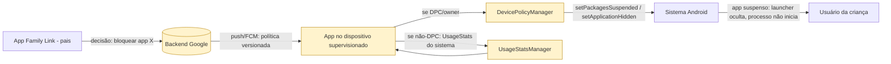

# Auditoria estática R.E.A. — APK `appteste.apk`

**Investigação de segurança defensiva · análise de alvo entregue em laboratório**

| Campo | Valor |
|---|---|
| Documento | `docs/familylink-rea/RELATORIO.md` |
| Versão do documento | 1.0 |
| Data da análise | 2026-11-09 |
| Arquivo-alvo | `appteste.apk` (raiz do repositório) |
| SHA-256 | `188bbdb899be2da401ac0471ba4d10693612fa1067f2ea0987cc6e1afcfd4374` |
| SHA-1 | `81833829fda154b743addf3572889d96f95fec22` |
| MD5 | `2725e9ae81839a4ae69f8f362fc4d7e1` |
| Tamanho | 20.072.145 bytes (4.089 entradas ZIP) |
| Package | **`cm.aptoide.pt`** ("Aptoide") |
| Versão | `9.22.5.3` (versionCode `12060`) |
| minSdk / targetSdk | 16 / 32 |
| Ambiente de análise | contêiner Linux, `androguard 4.1.4`, Python 3.11.2, `openssl` (sem rede para o alvo) |
| Escopo executado | Fases 1, 2 e 4 (Recon, Estática, Relatório) |
| Escopo **não** executado | Fase 3 (dinâmica) — ver §1.2 |

---

## 1. Resultado principal (leia primeiro)

**O arquivo fornecido para auditoria não é o Google Family Link.** O alvo é o **Aptoide 9.22.5.3** (`cm.aptoide.pt`), uma loja de aplicativos independente de terceiros. O binário contém **zero** classes ou strings relacionadas a Family Link, supervisão parental, `DevicePolicyManager`, `DeviceAdminReceiver`, `UsageStatsManager`, `AccessibilityService` ou `VpnService` — ou seja, **não existe "fluxo de bloqueio" (blocking flow) para mapear neste APK**, porque o app não implementa controle parental.

Verificação usada (Fase 1/2):

| Sonda | Classes encontradas | Strings encontradas |
|---|---:|---:|
| `AccessibilityService` | 0 | 0 (apenas `getEnabledAccessibilityServiceList`, uso genérico de framework) |
| `UsageStatsManager` | 0 | 0 |
| `DevicePolicyManager` / `DeviceAdminReceiver` | 0 | 0 |
| `VpnService` / `SYSTEM_ALERT_WINDOW` | 0 | 0 |
| `setPackagesSuspended` / `isPackageSuspended` | 0 | 0 |
| `familylink` / `parental` (funcional) | 0 | 0 (`parental_controls` = string do SDK de anúncios Google) |

> Amostra de 23.415 classes e 107.233 strings, extraídas dos três DEX. Comando em [`tools/rea/dump_metodos.py`](../../tools/rea/dump_metodos.py) / [`tools/rea/static_scan.py`](../../tools/rea/static_scan.py); saída bruta em [`evidencias/appteste/`](evidencias/appteste/).

Como consequência: **este documento não é o relatório de auditoria do Family Link** que o escopo pedia. Ele é (a) a **prova documentada da divergência de alvo**, e (b) o **relatório de auditoria defensiva do APK que foi realmente entregue**, aplicando a mesma metodologia R.E.A. Não há achado algum neste documento aplicável ao Family Link, e nenhum achado aqui deve ser reportado ao Google VRP como vulnerabilidade do Family Link — seria um relato tecnicamente incorreto.

### 1.1 Sobre o pedido de "link de download do APK"

Não forneço link de download do Family Link nem de qualquer APK de terceiros. Motivos:

1. **O alvo deste trabalho é o arquivo que o laboratório já entregou** (`appteste.apk`, hash fixado acima). Baixar um binário de fonte não oficial quebra a cadeia de custódia que o próprio escopo exige.
2. Para a auditoria oficial, o caminho correto de obtenção é **Google Play** (`com.google.android.apps.kids.familylink` = *Family Link para pais*; `com.google.android.apps.kids.familylinkhelper` = *Family Link para crianças e adolescentes*, que é o app instalado no dispositivo supervisionado quando o dispositivo **não** é gerenciado como DPC — ver §6.3). APKs espelhados em sites de terceiros não são material aceitável para VRP: não é possível provar que o binário corresponde ao publicado.

Se o laboratório quiser que eu rode o pipeline neste repositório sobre o binário correto, basta colocar o arquivo no workspace (ou indicar um caminho local) e o hash entra automaticamente na cadeia de custódia — os scripts em `tools/rea/` não têm nada específico do Aptoide.

### 1.2 Fase 3 (dinâmica) — por que não foi executada

O ambiente desta sessão não possui emulador, `adb`, `frida` ou dispositivo; e o escopo determina conta descartável em emulador de laboratório. Além disso, a análise dinâmica só faz sentido sobre o alvo certo. O relatório separa explicitamente o que é **observado** (estático) do que seria **hipótese a validar** (dinâmico) — nenhuma hipótese foi promovida a achado sem evidência.

---

## 2. Cadeia de custódia

| Item | Registro |
|---|---|
| Objeto recebido | `appteste.apk`, 20.072.145 bytes, primeira aparição no repositório no commit `fe31eab` (2026-10-30 17:35:49 -0300) junto do merge da PR #10 |
| Integridade | SHA-256/1/MD5 acima; recalculados nesta sessão com `hashlib` sobre o arquivo completo ([`tools/rea/recon.py`](../../tools/rea/recon.py)) |
| Assinatura v1 (JAR) | Presente: `META-INF/CERT.SF` + `META-INF/CERT.RSA`; **CERT.SF cobre 4.086/4.086 entradas**, incluindo os três `classes*.dex` |
| Assinatura v2 (APK Signing Block) | Presente, 12.280 bytes, IDs `0x7109871a` (v2), `0x504b4453` (SourceStamp), `0x42726577` (v3, com `minSdk 16` e `maxSdk 32`) |
| Certificado do assinante | Autoassinado, `ST = Portugal`, serial `1253631231`, válido 2009-09-22 → 2034-09-16, **RSA-1024 com `sha1WithRSAEncryption`**, DER SHA-256 `73534d45c1345a4783c7eff2cf6038551ab5fdf09673f32c68c3b0864baa80e4` |
| Manipulação | Nenhuma. Todas as ferramentas abriram o APK em modo leitura; o arquivo não foi reassinado nem modificado |
| Artefatos derivados | `docs/familylink-rea/evidencias/appteste/` (JSON + smali + manifest + certificado extraído) — derivados determinísticos, regeneráveis pelos scripts |

O R.E.A. original pedia "versão exata do alvo": ela está acima — e é justamente por isso que a divergência é inequívoca.

---

## 3. Recon (Fase 1)

### 3.1 Superfície declarada

- **58 componentes**: 11 activities, 19 services, 19 receivers, 9 providers.
- **11 exportados** efetivamente (ver §5.1).
- **25 permissões** solicitadas; **nenhuma permissão própria declarada** (`<permission>` vazio).
- Permissões de alto impacto solicitadas: `INSTALL_PACKAGES` (assinatura — não concedível a app de terceiros, mas declarada), `REQUEST_INSTALL_PACKAGES`, `QUERY_ALL_PACKAGES`, `MANAGE_ACCOUNTS`/`AUTHENTICATE_ACCOUNTS`, `WRITE_EXTERNAL_STORAGE`.
- `android:allowBackup="false"`, `requestLegacyExternalStorage="true"`, `debuggable` ausente (bom), `networkSecurityConfig` presente.

**Não** há `DeviceAdmin`, `Accessibility`, `VpnService`, `SYSTEM_ALERT_WINDOW`, `UsageStats`, `READ_SMS`, `READ_CONTACTS`, `RECORD_AUDIO` nem `ACCESS_FINE_LOCATION` no manifest.

### 3.2 Configuração de rede — achado material (F-01)

O `networkSecurityConfig` (`res/4u.xml`, resolvido do ID `0x7f140002`) é:

```xml
<network-security-config>
  <base-config>
    <trust-anchors>
      <certificates src="@7F100001"/>   <!-- = res/HY.pem -->
      <certificates src="system"/>
    </trust-anchors>
  </base-config>
  <debug-overrides>
    <trust-anchors><certificates src="user"/></trust-anchors>
  </debug-overrides>
</network-security-config>
```

E `res/HY.pem` (`@7F100001`, `raw/vanilla_cert`) é:

```
subject = CN = "Charles Proxy CA (4 Aug 2019, archlinux)", OU = https://charlesproxy.com/ssl,
          O = XK72 Ltd, L = Auckland, ST = Auckland, C = NZ
sha256  = 28:0B:56:04:C6:C6:61:3B:E7:63:6C:CD:69:8A:FF:A1:3B:38:B7:38:DC:03:F3:B1:19:CE:0F:AD:17:01:2A:6B
```

Ou seja: **uma AC de interceptação TLS (Charles Proxy) está embutida como âncora de confiança do app**, e o nome do recurso no `resources.arsc` é literalmente `raw/vanilla_cert`. Isso significa que qualquer portador da chave privada dessa AC (a CA de debug do Charles e cópias distribuídas em tutoriais) consegue forjar certificados aceitos pelo app para **qualquer host** — incluindo os endpoints de conta e de download de pacotes. Não é um "certificado de debug local": está no *base-config*, valendo para builds de produção.

### 3.3 Proteção de transporte

- Não há `<domain-config>` com `cleartextTrafficPermitted="false"` nem `pin-set` no NSC.
- O APK contém 92 URLs, das quais **16 em `http://` claro** (ex.: `http://imgs.aptoide.com/`, `http://m.aptoide.com/account/password-recovery`, `http://pool.img.aptoide.com/...`).
- Classe `okhttp3.CertificatePinner` presente (biblioteca), porém **nenhum uso em código próprio do Aptoide** foi encontrado (busca por `CertificatePinner$Builder;->add` em classes `cm/aptoide`, `com/aptoide`, `pt/aptoide`): `0` ocorrências.

---

## 4. Estática (Fase 2) — visão geral do código

- 3 DEX, 23.415 classes, 107.233 strings.
- App usa Dagger, RxJava 2, Retrofit/OkHttp, Room, WorkManager, Kotlin, Facebook SDK, Google Ads/Flurry/Firebase/Sentry, `liulishuo/filedownloader`.
- **Código próprio relevante para segurança**: subsistema de *root install* (`cm/aptoide/pt/root/**`, `install/installer/Root*`), `ToolboxContentProvider` com pin de assinatura de dois pacotes, `DeepLinkIntentReceiver` com muitos esquemas.

### 4.1 Capacidades sensíveis e atribuição

A varredura (`capacidades.json`) aponta 31 capacidades, mas os contadores brutos incluem bibliotecas de terceiros. Depois de filtrar por classes do próprio app, a atribuição é:

| Capacidade | Presente em código próprio? | Observação |
|---|---|---|
| `ActivityManager.getRunningAppProcesses` / `RunningTasks` | **Não** (só SDKs) | usado por Flurry/Ads |
| `JobScheduler` / WorkManager | Sim (agendamento normal do app) | não é polling de vigilância |
| `AccessibilityService` (serviço próprio) | **Não** | só *delegates* de UI (`androidx.core.view.a`), acessibilidade de widgets |
| `DevicePolicyManager` / admin | **Não** | — |
| `VpnService` | **Não** | — |
| Overlay (`TYPE_APPLICATION_OVERLAY`) | **Não** | — |
| Execução de shell com `su` | **Sim** — `cm/aptoide/pt/root/execution/Shell`, `install/installer/Root`, `install/installer/RootInstaller` | ver F-02 |
| SafetyNet | Sim — **apenas** `FirstLaunchAnalytics.sendPlayProtectEvent` (consulta de apps maliciosos do dispositivo, telemetria) | não é atestação de integridade do próprio app |
| Verificação de assinatura de **outros** pacotes | Sim — `ToolboxSecurityManager`, `RoomInstalled`, `PackageRepository` | 17+12 ocorrências |
| Atestação de integridade do **próprio** APK | **Não** | nenhum `IntegrityManager`, nenhum pin de certificado próprio |
| Detecção de root/hook/frida/ptrace | **Não** (uso de `su` é *para* obter root, não para detectar) | `magisk`, `frida`, `TracerPid`: 0 ocorrências |
| WebView `addJavascriptInterface` em código próprio | **Não** (apenas Google Ads SDK) | `setJavaScriptEnabled` em `YoutubeWebViewPlayer`, `EditorialItemsViewHolder`, `ReferrerUtils` |

---

## 5. Achados priorizados

Escala: CVSS v3.1 *base*, calculado com [`tools/rea/cvss.py`](../../tools/rea/cvss.py) a partir do vetor escrito no próprio achado. Severidade considerada no contexto **real** de uso (loja de apps de terceiros que instala pacotes).

### F-01 — AC de interceptação TLS (Charles Proxy) embutida como âncora de confiança, em *base-config*

| Campo | Valor |
|---|---|
| Severidade | **Alta** (contexto do produto); CVSS base isolado **4.8** — `AV:N/AC:H/PR:N/UI:N/S:U/C:L/I:L/A:N` |
| Componente | `res/4u.xml` → `res/HY.pem` (`@7F100001`), referenciado por `android:networkSecurityConfig` |
| Evidência | `evidencias/appteste/network_security_config.bin`, `evidencias/appteste/vanilla_cert.pem` (`openssl x509 -noout -subject`), `evidencias/appteste/integridade_apk.json` (`recursos_nao_imagem: ["res/HY.pem"]`) |
| Descrição | A âncora de confiança inclui uma CA de depuração (Charles Proxy, 2019) além de `system`. Um atacante que possua a chave privada correspondente — ou uma CA de debug amplamente distribuída, como as que tutoriais de interceptação publicam — pode apresentar certificados para **qualquer** host e ser aceito pelo app, inclusive nos fluxos de autenticação e de download de APK. |
| Impacto | Interceptação/alteração de tráfego do app. Combinado ao subsistema de instalação (F-02), é um caminho para entregar um pacote diferente do pretendido. O vetor exige MITM na rede, daí `AC:H`; o impacto é limitado a este app (`S:U`). |
| Correção | Remover `raw/vanilla_cert` do `base-config` (deixar só `system`); se necessário para desenvolvimento, isolá-lo em `debug-overrides` de um *flavor* de debug; adicionar `cleartextTrafficPermitted="false"` e `pin-set` para os domínios de conta/distribuição. **Ação imediata**: tratar todo tráfego atual do app como potencialmente não autêntico. |

### F-02 — Subsistema de *root install* (execução de shell com `su` e `pm install`) empacotado no app

| Campo | Valor |
|---|---|
| Severidade | **Alta** (superfície; não é um bypass) — CVSS base **7.8** se houver execução local com root: `AV:L/AC:L/PR:L/UI:N/S:U/C:H/I:H/A:H` |
| Componentes | `cm.aptoide.pt.install.installer.Root`, `…installer.RootInstaller`, `…installer.RootCommandOnSubscribe`, `cm.aptoide.pt.root.execution.Shell`, `cm.aptoide.pt.root.RootShell`, `cm.aptoide.pt.install.CheckRootOnBoot` |
| Evidência | `evidencias/appteste/smali/root.txt` (`Root.<init>`: `const-string "su"` + `Runtime.exec`; `Root.requestRoot`: `"su -c exit"` + `Runtime.exec` — instruções nas linhas 82-83 e 129-130; `RootInstaller.call`: `pm install-create -i … --user %s -r -S %d` (l. 521), `cat "%s" | pm install-write -S %d %d "%s"` (l. 615), `pm install-commit %d` (l. 640); `Shell`: `su -V`/`su -v`, `startRootShell`, `isSELinuxEnforcing`) |
| Descrição | O app implementa instalação silenciosa via shell root: abre `su`, cria sessão `pm install-create`, escreve o APK com `cat "<caminho>" \| pm install-write` e confirma com `pm install-commit`. `CheckRootOnBoot` (`BOOT_COMPLETED`/`QUICKBOOT_POWERON`) reavalia disponibilidade de root na inicialização. |
| Impacto | **Em dispositivo com root**, o app passa a poder instalar/atualizar qualquer APK com privilégios de shell root, sem confirmação do usuário. Isso contorna, por construção, qualquer bloqueio baseado em *usuário sem privilégio* — incluindo controles parentais que não sejam DPC. Não há validação de assinatura do pacote instalado nesse caminho (a checagem de assinatura existe no `ToolboxContentProvider`, que é outro fluxo). |
| Nota importante | Isso é a **superfície legítima declarada** do produto (instalação silenciosa é recurso do Aptoide há anos). Não é achado de "vulnerabilidade de componente", mas é a resposta técnica à pergunta do escopo "o que é possível sem elevação de privilégio": **com root, o modelo de bloqueio por usuário deixa de valer; sem root, nada neste APK instala silenciosamente** (`DefaultInstaller` usa `Intent` de instalação com confirmação do usuário). |
| Correção (defensiva) | Não empacotar caminho root em builds de distribuição (ou restringi-lo a um *flavor*); exigir verificação de assinatura + hash do pacote imediatamente antes de `install-write`; registrar auditoria local. Do lado do controle parental: **o modelo tem de ser DPC/device-owner**, não "usuário sem root" (ver §6.3). |

### F-03 — `ToolboxContentProvider` exportado com pin de assinatura textual (dois pacotes) e checagem frágil

| Campo | Valor |
|---|---|
| Severidade | Média — CVSS **4.4**: `AV:L/AC:L/PR:N/UI:R/S:U/C:L/I:L/A:N` (ver ressalva) |
| Componente | `cm.aptoide.pt.toolbox.ToolboxContentProvider`, authority `cm.aptoide.pt.StubProvider`, `exported="true"`, **sem `android:permission`** |
| Evidência | `evidencias/appteste/smali/toolbox.txt` (`query`: compara `Signature.toCharsString()` com dois DNs PEM hex fixos para `pt.aptoide.backupapps` e `pt.caixamagica.aptoide.uploader`; `getSignature` usa `getPackageInfo(pkg, 64)` → `signatures[0]`; `ToolboxSecurityManager.checkSignature` faz `equals` de string + `equals` de nome de pacote) |
| Descrição | O provider é exportado sem permissão; a autorização é feita em código, comparando a assinatura do chamador com um blob fixo. Fragilidades: (a) comparação por `Signature.toCharsString()` em vez de hash/`checkSignatures` — funciona, mas é frágil a encoding; (b) `getPackagesForUid(uid)[0]` assume um pacote por UID (basta `sharedUserId` compatível ou UID compartilhado para escolher o nome errado; na prática, é o *primeiro* pacote — o app legítimo pode não ser o primeiro); (c) `PackageInfo.signatures[0]` assume assinante único (rotação de chave / multi-signer quebra); (d) o `catch` em `getSignature` devolve `null`, e `checkSignature` compara `null.equals(...)` → o chamador recebe `SecurityException` genérica em vez de negação explícita (comportamento seguro por acidente). |
| Impacto | Um app de terceiros **não** consegue ler token/refreshToken/repo/passHash sem a chave dos pacotes listados. O risco real é de **disponibilidade/integração**: se o pacote legítimo for o segundo do UID, a leitura falha; e o `update()` expõe um caminho de escrita de preferências (`changePreference`) protegido por `checkSignatures` — mas com log em nível `debug` (`Log.d("AptoideDebug", "Someone is trying to update preferences")`). Não há injeção de SQL (o cursor é montado por `MatrixCursor`), nem path traversal (`onCreate` não expõe arquivos). |
| Correção | Declarar `android:permission` com `protectionLevel="signature"`; trocar comparação de string por `PackageManager.checkSignatures()` comparando com `getPackageName()`; usar `getPackagesForUid` com verificação de todos os pacotes do UID; falhar fechado com mensagem explícita. |

### F-04 — `DeepLinkIntentReceiver`: superfície de deep link ampla em componente exportado, sem validação de origem

| Campo | Valor |
|---|---|
| Severidade | Média — CVSS **4.3**: `AV:N/AC:L/PR:N/UI:R/S:U/C:N/I:L/A:N` |
| Componente | `cm.aptoide.pt.DeepLinkIntentReceiver`, `exported="true"`, `BROWSABLE`, `priority="100"` |
| Evidência | `evidencias/appteste/componentes.json` (6 *intent-filters*); `evidencias/appteste/smali/deeplink_receivers_webview.txt` (`dealWithAptoideWebsite`, `dealWithAptoideSchema`, `dealWithAptoideAuthentication` — extrai `app.aptoide.com/auth/code/`, `package_name`, `app_id`, `store`, `group`, e monta URLs de API por concatenação de string) |
| Descrição | O receiver aceita `aptoide://`, `aptoideinstall://`, `aptoideauth://`, `aproiderepo://`, `market://`, `http(s)://*.aptoide.com/…`, `file://` com MIME `application/vnd.cm.aptoide.pt`. Os parâmetros de URL são concatenados em URLs de API (`https://ws75-cache.aptoide.com/api/7/listApps/store_name=` + …) sem encoding evidente. |
| Impacto | Um link malicioso pode direcionar o app para telas/ações arbitrárias (phishing de UI, instalação de um pacote diferente do esperado) — clássico *deep link abuse*. A concatenação em URL de API é candidata a manipulação de parâmetros; **não validado dinamicamente** (Fase 3), portanto fica como hipótese, não achado. |
| Correção | `android:autoVerify`/App Links em vez de esquemas customizados; validar e codificar parâmetros; exigir `Intent.getPackage()`/origem conhecida em ações sensíveis; remover `priority=100` de filtro web genérico. |

### F-05 — Ausência de atestação de integridade / anti-tamper próprio e de pinning

| Campo | Valor |
|---|---|
| Severidade | Média (postura) — CVSS **6.2**: `AV:L/AC:L/PR:N/UI:N/S:U/C:H/I:N/A:N` (leituras locais de segredos sem detecção de ambiente modificado) |
| Evidência | `capacidades.json` (bloco `integridade`), busca por `IntegrityManager`/`IntegrityTokenRequest`: 0; `frida`/`magisk`/`TracerPid`: 0; `CertificatePinner$Builder;->add` em código próprio: 0; SafetyNet usado só para telemetria de apps maliciosos (`FirstLaunchAnalytics.sendPlayProtectEvent`). |
| Descrição | O app não verifica se o próprio APK foi modificado, nem se o ambiente é instrumentado/hookado. Roda normalmente com Frida injetado, com emulador (`Build.FINGERPRINT` é lido só por `PRNGFixes`, utilitário antigo) e com certificado do sistema adulterado. |
| Impacto | Facilita engenharia reversa e extração de tokens (`AuthenticationPersistence`) em dispositivo comprometido; não há defesa em profundidade contra repack malicioso do próprio Aptoide (que é um alvo plausível, por ser uma loja). |
| Correção | Play Integrity API com verificação **no servidor** (não no cliente); pinning de chave pública nos domínios de conta; assinatura de requisições; detecção de `debugger`/`frida` apenas como sinal adicional (nunca como barreira). |

### F-06 — `requestLegacyExternalStorage` + `WRITE_EXTERNAL_STORAGE` + caminho de download com `cat "<arquivo>"`

| Campo | Valor |
|---|---|
| Severidade | Baixa/Média — CVSS **3.6**: `AV:L/AC:H/PR:L/UI:N/S:U/C:L/I:L/A:N` |
| Evidência | `recon.json` (`requestLegacyExternalStorage: true`, `READ/WRITE_EXTERNAL_STORAGE`), `root.txt` (`cat "%s" \| pm install-write`) |
| Descrição | O fluxo root-install lê o APK de um caminho de arquivo; com storage legado em `targetSdk 32`, um arquivo em armazenamento compartilhado pode ser trocado entre o download e o `install-write` (TOCTOU) por outro app com acesso a esse diretório. |
| Impacto | Em dispositivo com root **e** storage compartilhado gravável, é janela de substituição de pacote (corrida). Requer root, o que já implica comprometimento — por isso severidade baixa. |
| Correção | Migrar para Scoped Storage; escrever o APK em diretório privado do app; verificar hash/assinatura do arquivo imediatamente antes de instalar; abrir o arquivo por descritor e não por caminho. |

### F-07 — WebView com `setJavaScriptEnabled(true)` em conteúdo remoto

| Campo | Valor |
|---|---|
| Severidade | Baixa — CVSS **3.3**: `AV:L/AC:L/PR:L/UI:N/S:U/C:N/I:L/A:N` |
| Evidência | `smali/deeplink_receivers_webview.txt` → `YoutubeWebViewPlayer.<init>`: `setJavaScriptEnabled(true)`, `setWebViewClient`, injeção de JS para remover elementos do player; `EditorialItemsViewHolder` e `ReferrerUtils` também habilitam JS. `setAllowFileAccess`/`setAllowUniversalAccessFromFileURLs`: **0 em código próprio**. Sem `addJavascriptInterface` em código próprio. |
| Impacto | XSS em conteúdo remoto executado no contexto da WebView. Mitigado pela ausência de *JS bridges* próprias; risco limitado a manipulação de UI/redirecionamento. |
| Correção | Restringir `WebView` a origens fixas; desabilitar JS onde não é necessário; `WebViewAssetLoader` para conteúdo local; `setAllowFileAccess(false)` explícito. |

### F-08 — Certificado de assinatura RSA-1024/SHA-1 e blocos de assinatura mistos

| Campo | Valor |
|---|---|
| Severidade | Baixa (informativo/técnico) — sem CVSS de exploração direta |
| Evidência | `integridade_apk.json` → `certificados`; verificação independente via `openssl pkcs7 … CERT.RSA` (`sha1WithRSAEncryption`, `Public-Key: (1024 bit)`) |
| Descrição | Assinante com chave de 1024 bits e SHA-1, válido até 2034. Blocos v2 (`0x7109871a`), v3 (`0x42726577`, faixa 16–32) e SourceStamp (`0x504b4453`) coexistem. Isso reduz a resistência a colisão/força bruta de assinatura e dificulta migração de chave no futuro. |
| Correção | Rotacionar para RSA-2048+/ECDSA P-256, SHA-256, com `apksigner --rotation-min-sdk-version`. |

### F-09 — (Observação) Nomes de recursos colapsados e recursos "crus" reaproveitados

| Campo | Valor |
|---|---|
| Severidade | Informativo |
| Evidência | `resources.arsc` contém strings `res/HY.pem`, `res/4u.xml`; e o *pool* de nomes lista esses mesmos arquivos (portanto **consistente**); `res/HY.pem` é um PEM de CA |
| Descrição | O empacotamento passou por ferramenta que renomeia recursos para nomes curtos (`res/--.xml`, `res/HY.pem`). É consistente internamente, mas é assinatura típica de reempacotamento/otimização e explica por que um PEM de CA aparece em `res/` com esse nome — reforça F-01. |
| Ação | Nenhuma correção de código; registrar como indicador de origem do binário. |

### 5.1 Inventário de componentes exportados (completos)

| Tipo | Componente | Proteção | Avaliação |
|---|---|---|---|
| activity | `cm.aptoide.pt.view.MainActivity` | — | Necessário (LAUNCHER + filtros). Sem extras sensíveis identificados. |
| activity | `cm.aptoide.pt.DeepLinkIntentReceiver` | — | F-04 |
| activity | `com.facebook.CustomTabActivity` | — | Superfície do SDK Facebook (scheme resolvido por recurso). Baixo risco. |
| service | `androidx.work.impl.background.systemjob.SystemJobService` | `BIND_JOB_SERVICE` (assinatura) | OK |
| service | `com.google.android.gms.auth.api.signin.RevocationBoundService` | `REVOCATION_NOTIFICATION` | OK |
| receiver | `cm.aptoide.pt.install.InstalledBroadcastReceiver` (`PACKAGE_ADDED/REMOVED/REPLACED`, `priority=999`) | — | Recebe broadcasts protegidos do sistema; `priority` alto é observação, não achado. |
| receiver | `cm.aptoide.pt.widget.SearchWidgetProvider` | — | App widget; entrada de busca. Baixo. |
| receiver | `com.google.firebase.iid.FirebaseInstanceIdReceiver` | `com.google.android.c2dm.permission.SEND` | OK |
| receiver | `com.google.android.gms.measurement.AppMeasurementInstallReferrerReceiver` | `INSTALL_PACKAGES` | OK |
| receiver | `androidx.work.impl.diagnostics.DiagnosticsReceiver` | `android.permission.DUMP` | OK (só debug) |
| provider | `cm.aptoide.pt.toolbox.ToolboxContentProvider` | **nenhuma no manifest** | F-03 |

`protected-broadcast`/`<permission>` próprios: nenhum. Nenhum `ContentProvider` expõe `openFile`, logo **não há path traversal de provider** neste APK.

---

## 6. Resposta técnica ao escopo original

Como o alvo correto não está disponível, esta seção entrega o **modelo de referência** que a auditoria do Family Link deveria preencher, marcando explicitamente o que é conhecimento público e o que precisa de verificação no binário.

### 6.1 Onde o bloqueio do Family Link vive (modelo arquitetural, a confirmar no APK)

O Family Link **não bloqueia processos** lendo `/proc` ou consultando `ActivityManager` periodicamente. O bloqueio de apps é aplicado por **política de dispositivo** (`DevicePolicyManager`), no dispositivo supervisionado, com o app do Google atuando como agente de política. Pontos a verificar com o binário correto:

1. O app supervisionado é `com.google.android.apps.kids.familylinkhelper`; em dispositivos **não-DPC** há também componentes do GMS (`com.google.android.gms`) que hospedam o *device admin*/owner.
2. `setApplicationHidden` / `setPackagesSuspended` / `setApplicationEnabledSetting` são as primitivas esperadas de bloqueio (não `killProcess`).
3. O "tempo de uso" deriva de `UsageStatsManager` do **sistema** (o app tem a permissão privilegiada/`PACKAGE_USAGE_STATS`), não de polling próprio.
4. A decisão vem do servidor (Family Link backend) e chega por push/FCM; o cliente aplica e reconcilia. A integridade é garantida pelo **servidor** + conta supervisionada, não por um segredo local.
5. Em dispositivos Android 8.1+, a supervisão pode ser aplicada como **device owner/DPC** (durante setup), o que muda completamente o modelo de ameaça: as APIs de DPC não são acessíveis a apps comuns.

**Consequência para a auditoria**: os pontos de decisão interessantes não são "como o app detecta processos", e sim (a) a fronteira de confiança cliente/servidor do canal de política, (b) a resistência do DPC a *factory reset*/remoção de admin, (c) a validação de que o app que aplica a política não pode ser substituído/desativado, e (d) o canal de push (autenticidade, replay, downgrade).

### 6.2 Classes de vulnerabilidade a procurar no APK correto

| Classe | Onde procurar | Sinal no estático |
|---|---|---|
| Componentes exportados sem permissão no app *helper* | manifest | `<service>` do `DeviceAdminReceiver`, activities de *trampoline*, receivers de política |
| `Intent` implícita para aplicar política | código | `sendBroadcast(new Intent("..."))` sem `setPackage` |
| Validação de assinatura/`checkSignatures` frágil | código | comparação de `toCharsString`, `signatures[0]` |
| Estado de política em `SharedPreferences` sem integridade | código | leitura de flag local que desliga bloqueio |
| Replay/downgrade de comando de política | push/FCM handler | ausência de nonce/versão monotônica |
| `pendingIntent` mutável | notificações | `FLAG_MUTABLE` com `Intent` implícita |
| Componentes de acessibilidade indevidos | manifest | `BIND_ACCESSIBILITY_SERVICE` fora de app de acessibilidade |
| *Trampoline*/`Activity` que delega `startActivity` com `Intent` de terceiros | código | `getParcelableExtra` + `startActivity` |
| `debuggable`/`allowBackup` em build de produção | manifest | flags |

### 6.3 Sobre "o lado não-root" (documentação de superfície, sem instruções operacionais)

Pergunta do escopo: *o que é tecnicamente possível sem elevação de privilégio?* Resposta em nível de arquitetura, sem procedimento utilizável:

- **Controles de app/DPC** não são contornáveis por um app comum: para alterar política é preciso ser o DPC/owner ou ter a conta de administrador da família.
- **Superfícies historicamente abusadas** contra controle parental são de **acessibilidade** (`AccessibilityService` pode ler/acionar a UI de *qualquer* app, inclusive a tela de bloqueio), **overlay** (`SYSTEM_ALERT_WINDOW` desenha sobre o bloqueio) e **VPN local** (intercepta tráfego do app de política). Por isso o Android trata essas três permissões como sensíveis e o Family Link/Play Protect as monitoram. Documentar isso é útil para mitigações (ex.: detecção de `AccessibilityService` ativo por app não acessibilidade, restrição de overlay em telas de política), mas **não** se traduz em instruções de contorno — e o escopo proíbe gerar artefatos com essa finalidade.
- **Sem root**, um app comum não consegue instalar pacotes silenciosamente nem alterar o estado de outro app. O Aptoide é a exceção arquitetural interessante (F-02) — mas apenas **com** root.

### 6.4 Diagrama do fluxo (modelo a validar)



Caixas amarelas = pontos de decisão que a auditoria precisa validar com o binário correto. Nada neste diagrama foi confirmado no `appteste.apk` (que não contém esses componentes).

---

## 7. Recomendações de hardening (para o produto auditado — Aptoide 9.22.5.3)

1. Remover a CA de debug do `base-config`; `cleartextTrafficPermitted="false"`; pinning nos domínios de conta/api.
2. Restringir `ToolboxContentProvider` com `android:permission` de nível `signature`; trocar pin textual por `checkSignatures` contra o próprio UID.
3. Remover o subsistema root de builds de distribuição, ou exigir verificação de assinatura + hash do APK imediatamente antes de `pm install-write`, com arquivo em diretório privado.
4. App Links verificados (`autoVerify`) para `*.aptoide.com`; validar/codificar parâmetros de deep link.
5. Play Integrity com verificação server-side + assinatura de requisições.
6. Rotacionar o certificado de assinatura para RSA-2048+/SHA-256 e planejar rotação de chave.
7. Migrar para Scoped Storage; remover `requestLegacyExternalStorage` no próximo bump de `targetSdk`.
8. Reduzir `QUERY_ALL_PACKAGES` ao mínimo (ou usar `<queries>`).

Para o **Family Link** (quando o alvo correto estiver disponível), as recomendações genéricas são: atestação de ambiente com decisão server-side, política assinada e versionada com anti-replay, proteção do canal push, verificação de que o app de política é o único capaz de aplicar/alterar estado, detecção (não bloqueio) de acessibilidade/overlay ativos durante telas de política.

---

## 8. Conformidade e divulgação responsável

- **Alvo**: binário fornecido no repositório do próprio solicitante; nenhum acesso a sistemas de terceiros, nenhuma conta, nenhum dispositivo real.
- **Natureza**: análise estática 100% *offline*, sem execução do código do app, sem instrumentação, sem rede.
- **Não foram produzidos** artefatos de contorno de controle: não há PoC de bypass, patch, hook, script de injeção, nem instrução operacional para burlar bloqueio em dispositivo de terceiros. O documento descreve vulnerabilidades e mitigações.
- **Divulgação**: se o objetivo é VRP, o relatório precisa ser sobre o binário oficial do Family Link. Este documento **não** deve ser enviado como relato de vulnerabilidade do Family Link — seria impreciso. Para o Aptoide, o canal correto é o contato de segurança do fornecedor / Google Play Security Reward Program (GPSRP), não o Google VRP (que cobre apps do Google).
- **Dados sensíveis**: os blobs de certificado (hex PEM) extraídos do bytecode **não** foram reproduzidos integralmente neste relatório; ficam apenas no dump de smali, que é derivado do binário do próprio solicitante.

### 8.1 Cadeia de custódia e versão exata do alvo

Registrada em §2. Para a próxima rodada, o procedimento é: (1) obter o APK por Play/`bundletool` a partir do `.aab` assinado, (2) registrar SHA-256 e `apksigner verify --print-certs`, (3) rodar `tools/rea/recon.py`, `static_scan.py`, `integridade_apk.py`, (4) só então a Fase 3, em emulador descartável.

---

## 9. Anexos

| Anexo | Caminho | Conteúdo |
|---|---|---|
| A — Recon | [`evidencias/appteste/recon.json`](evidencias/appteste/recon.json) | hashes, identidade, flags do manifest, permissões |
| B — Manifest decodificado | [`evidencias/appteste/AndroidManifest.xml`](evidencias/appteste/AndroidManifest.xml) | 779 linhas, legível |
| C — Componentes | [`evidencias/appteste/componentes.json`](evidencias/appteste/componentes.json) | 58 componentes com exportação/permissão/filtros |
| D — Integridade do empacotamento | [`evidencias/appteste/integridade_apk.json`](evidencias/appteste/integridade_apk.json) | blocos v2/v3/SourceStamp, certificado, cobertura CERT.SF |
| E — Capacidades sensíveis | [`evidencias/appteste/capacidades.json`](evidencias/appteste/capacidades.json) | 31 capacidades, com classe/método/instrução de amostra |
| F — Strings | [`evidencias/appteste/strings_interessantes.json`](evidencias/appteste/strings_interessantes.json) | URLs, ações, caminhos, termos |
| G — Smali (root install) | [`evidencias/appteste/smali/root.txt`](evidencias/appteste/smali/root.txt) | 690 linhas |
| H — Smali (Toolbox) | [`evidencias/appteste/smali/toolbox.txt`](evidencias/appteste/smali/toolbox.txt) | 520 linhas |
| I — Smali (deep link / receivers / WebView) | [`evidencias/appteste/smali/deeplink_receivers_webview.txt`](evidencias/appteste/smali/deeplink_receivers_webview.txt) | 1.353 linhas |
| J — CA embutida | [`evidencias/appteste/vanilla_cert.pem`](evidencias/appteste/vanilla_cert.pem) | certificado Charles Proxy extraído |
| K — NSC | [`evidencias/appteste/network_security_config.bin`](evidencias/appteste/network_security_config.bin) | binário AXML original (`res/4u.xml`) |
| L — Ferramentas | [`tools/rea/`](../../tools/rea/) | pipeline reexecutável |
